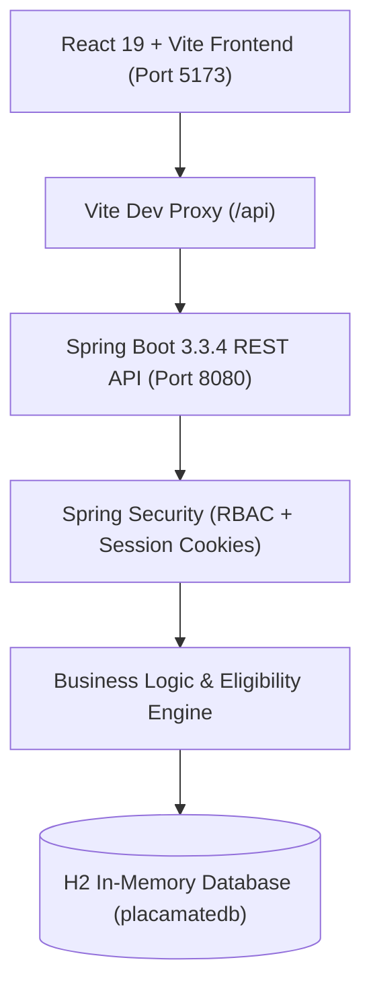

# 🎓 PLACAMATE — Smart Campus Placement Platform
> *"Where Talent Meets Opportunity"* • SRM University Campus Placement SaaS Platform

[](https://spring.io/projects/spring-boot)
[](https://vitejs.dev)
[](https://www.oracle.com/java/)
[-purple.svg)](#)

---

## 🌟 Executive Overview

**PLACAMATE** is an enterprise-grade university campus placement SaaS platform modeled after Tier-1 placement cells (such as SRM University Career Centre). 

Unlike generic job portals, PLACAMATE manages the complete university placement lifecycle across **three interconnected portals**:
1. **🎓 Student Portal**: Personalized student dashboard, verified university academic records, master PDF resume upload & parsing, live campus drives discovery, automated eligibility engine, real-time application status tracker, and interview scheduler integration.
2. **🏢 Recruiter Portal**: Corporate dashboard, campus drive creation with automated eligibility cutoff rules (CGPA, department filter, backlog ceiling, graduation batch), candidate screening ATS board, resume evaluation, interview scheduling, and offer rollout.
3. **🏛️ Placement Officer (Admin) Portal**: Central university command centre, real-time placement absorption metrics, department-wise placement charts, compensation package tier brackets, verified student registry, corporate relations directory, and 1-click NIRF/NAAC compliant CSV export.

---

## 🚀 Live Demo Quick Switcher

For live evaluation and presentation, the top navigation banner features a **1-Click Interactive Demo Role Switcher**:

| Role | Name | Email | Password | Role Description |
| :--- | :--- | :--- | :--- | :--- |
| **🎓 Student 1** | Aravind Swaminathan | `aravind@srmist.edu.in` | `student123` | B.Tech CSE (9.35 CGPA, 0 BL) • Applied to Google & MSFT |
| **🎓 Student 2** | Sneha Reddy | `sneha@srmist.edu.in` | `student123` | B.Tech AI & ML (8.85 CGPA, 0 BL) • Placed at TCS |
| **🏢 Google Recruiter** | Sundararajan Ramesh | `recruiter@google.com` | `google123` | Lead University Scout • Software Engineer (₹28.5 LPA) |
| **🏢 Microsoft Recruiter**| Ananya Deshmukh | `recruiter@microsoft.com` | `msft123` | Senior Campus Recruiter • SDE 1 (₹24.0 LPA) |
| **🏛️ Placement Officer** | Dr. K. S. Ravichandran | `officer@srmist.edu.in` | `officer123` | Head of Career Centre • University Central Admin |

---

## ⚙️ Architecture & Tech Stack



### Backend (Spring Boot 3.3.4 & Java 21)
- **Spring Security 6**: Role-Based Access Control (`STUDENT`, `RECRUITER`, `PLACEMENT_OFFICER`) with session authentication.
- **Spring Data JPA & Hibernate**: Relational schema spanning Users, Students, Recruiters, Companies, Jobs, Applications, Interviews, and Notifications.
- **Eligibility Engine**: Real-time evaluation of candidate CGPA, backlogs, department matching, graduation batch, and 10th/12th percentages with clear diagnostic failure reasons.
- **H2 In-Memory Database**: Pre-seeded with realistic companies (Google, Microsoft, Amazon, TCS), verified candidates, jobs, and scheduled interview rounds. Accessible at `/h2-console`.
- **Multipart File Storage**: Secure PDF resume upload, verification, and streaming download.

### Frontend (React + Vite + Vanilla CSS)
- **Midnight Sapphire Design System**: Modern dark-mode palette, frosted glassmorphism, glowing status badges, and typography (Plus Jakarta Sans).
- **Automated Eligibility Badges**: Live indicators with diagnostic modals detailing requirements.
- **Interactive Confetti**: Celebratory feedback on campus application submissions.
- **Unified ATS Board**: Stage progression dropdowns (Applied ➔ Shortlisted ➔ Interview Scheduled ➔ Selected).
- **Accreditation Export**: Instant CSV placement audit generation.

---

## 🛠️ How to Run Locally

### 1. Spring Boot Backend
```bash
cd backend
.\mvnw.cmd spring-boot:run
```
*Backend runs on `http://localhost:8080`*  
*H2 Console: `http://localhost:8080/h2-console` (JDBC URL: `jdbc:h2:mem:placamatedb`, User: `sa`, Password: empty)*

### 2. React Vite Frontend
```bash
cd frontend
npm install
npm run dev
```
*Frontend runs on `http://localhost:5173`*

---

## 📋 Key Placement Features Demonstrated for Marks Evaluation

1. **Role-Based Workflows**: True multi-actor system where students, recruiters, and placement officers each have dedicated perspectives, permissions, and dashboards.
2. **Automated Eligibility Engine**: Dynamically calculates whether a candidate can apply based on academic criteria and prevents ineligible applications.
3. **Interview Lifecycle**: Recruiters schedule virtual or on-campus rounds with meeting links; candidates receive alerts and direct meeting access.
4. **Verified University Resume Hub**: PDF resume uploading with instant in-browser viewing for corporate recruiters.
5. **Accreditation Analytics**: Department placement percentages and CTC salary tier analytics with one-click CSV export.
